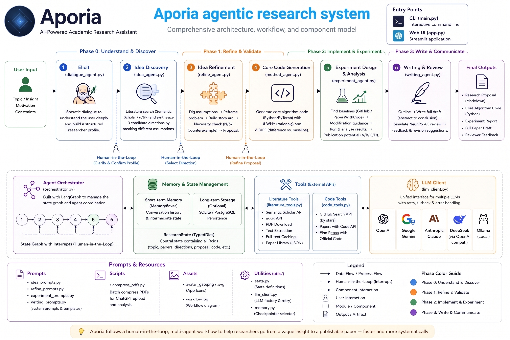

<div align="center">
  

  # Aporia

  **An agentic assistant from initial intuition to structured paper drafts**

  From a vague research frustration to a breakable assumption, a falsifiable story arc, an annotated core algorithm, and a complete manuscript draft — all within a single multi-agent pipeline.

  [](https://www.python.org/downloads/)
  [](https://github.com/langchain-ai/langgraph)
  [](https://streamlit.io)
  [](LICENSE)

  [Quick Start](#quick-start) · [Workflow](#workflow) · [Architecture](#architecture) · [Configuration](#configuration)

  English | [简体中文](README.zh.md)

</div>

---

## Why Aporia?

Most AI research tools assume you already have a clear topic. Aporia works at the moment *before* that — when you only have a gut feeling that something is off. It surfaces implicit assumptions, breaks them, and builds a logically closed story arc that leads to a concrete, executable research plan.

## Workflow

Aporia is a **5-phase, LangGraph-driven multi-agent pipeline**:

| Phase | Agent | What it does |
|-------|-------|--------------|
| **1. Input** | — | Capture your research direction and intuition |
| **2. Idea Discovery** | `idea_agent` | Search papers (Semantic Scholar / arXiv), mine implicit assumptions, generate 3 candidate directions |
| **3. Idea Refinement** | `refine_agent` | Break assumptions, reframe problems, construct story arc, run necessity check, draft research proposal |
| **4. Experiment** | `experiment_agent` | Search GitHub / PapersWithCode baselines, generate code modification guidance, analyze results |
| **5. Writing** | `writing_agent` | Outline → section-by-section draft → simulated reviewer feedback |

Each phase preserves state via LangGraph's checkpoint system, allowing pause and resume at any point.

## Key Features

- **Friction-first, not topic-first** — start from what bothers you, not what you've already decided
- **Assumption breaking over gap filling** — directions that challenge a field's premises, not incremental add-ons
- **Story arc with necessity check** — every component must trace to a "because X, we must have Y"
- **Multi-provider LLM** — Gemini / OpenAI / Anthropic / DeepSeek, switchable in the sidebar
- **Card-based direction selection** — clickable cards with live highlight for candidate directions
- **Progress timeline** — sidebar shows current stage with completed / in-progress / pending states
- **Breadcrumb navigation** — always know where you are in the pipeline
- **Live status updates** — `st.status` containers show real-time step-by-step progress
- **Custom spinner** — blue arc indicator replaces native running-man animation
- **Deep space blue theme** — `#0B111D` background, `#3A86FF` accent, geometric avatar
- **Session checkpoints** — pause and resume any node with LangGraph persistence

## Quick Start

### Prerequisites

- Python 3.11+
- At least one LLM API key (DeepSeek, OpenAI, Gemini, or Anthropic)

### Web UI (recommended)

```bash
git clone https://github.com/Saytoblue/Aporia
cd Aporia
pip install -r requirements.txt

cp .env.example .env
# add your API key to .env

streamlit run app.py
```

Open http://localhost:8501. Expand **Configuration** in the sidebar, select your LLM provider, enter your API key, and start a session.

### CLI

```bash
python main.py
# or resume a session:
python main.py --resume SESSION_ID
```

The CLI opens with a single question. Answer naturally — there's no form to fill in. Any language works.

## Architecture



```
User Input (topic + intuition)
        │
        ▼
  agents/orchestrator.py   ← LangGraph state graph (7 nodes, 3 interrupt points)
        │
   ┌────┼────┬────┬────┬────┐
   ▼    ▼    ▼    ▼    ▼    ▼
dialogue  idea  refine  method  experiment  writing
        │
        ▼
  tools/literature_tools.py   +   tools/code_tools.py   ← external APIs
        │
        ▼
  utils/llm_client.py   ← unified LLM client (4 providers)
```

| Directory | Purpose |
|-----------|---------|
| `agents/` | 7 agents: elicitation → discovery → refinement → method → experiment → writing |
| `tools/` | External API calls: Semantic Scholar, arXiv, GitHub, PapersWithCode |
| `utils/` | Infrastructure: `ResearchState` (TypedDict), LLM client factory, checkpoint persistence |
| `prompts/` | Prompt templates for each agent |
| `assets/` | Static resources: avatar, workflow diagram |

## LLM Providers

Aporia supports 4 LLM backends, selectable in the sidebar:

| Provider | Model (configurable) | Notes |
|----------|---------------------|-------|
| **DeepSeek** | deepseek-v4-pro | OpenAI-compatible API; default provider |
| **Gemini** | gemini-1.5-flash | Google Generative AI |
| **OpenAI** | gpt-4o | GPT-4o / GPT-4 / custom base URL |
| **Anthropic** | Claude | Claude series via Anthropic API |

Built-in retry logic handles rate limiting, network errors, and Gemini model fallback.

## Configuration

| Environment Variable | Description | Default |
|---------------------|-------------|---------|
| `DEEPSEEK_API_KEY` | DeepSeek API key | — |
| `DEEPSEEK_MODEL` | DeepSeek model name | deepseek-v4-pro |
| `DEEPSEEK_BASE_URL` | DeepSeek API endpoint | https://api.deepseek.com |
| `GEMINI_API_KEY` | Gemini API key | — |
| `OPENAI_API_KEY` | OpenAI API key | — |
| `ANTHROPIC_API_KEY` | Anthropic API key | — |
| `RESEARCH_AGENT_LLM_PROVIDER` | Default provider | deepseek |
| `RESEARCH_AGENT_PAPER_LIMIT` | Max papers per search | 60 |
| `RESEARCH_AGENT_RERANK_CANDIDATES` | Papers to re-rank | 30 |
| `SEMANTIC_SCHOLAR_API_KEY` | Semantic Scholar API key (optional) | — |

See `.env.example` for the full list.

## Scope

**Applicable:** empirical research involving code — CS (CV / NLP / ML / Systems), computational biology, data science, computational physics/chemistry.

**Not applicable:** pure mathematical proofs, humanities/social-science hermeneutics, clinical trials requiring ethical review.

## Roadmap

- [x] Multi-provider LLM (DeepSeek / Gemini / OpenAI / Anthropic)
- [x] Streamlit Web UI with deep space theme
- [x] Card-based direction selection
- [x] Progress timeline and breadcrumb navigation
- [ ] Evaluation benchmark for idea quality
- [ ] Local model support (Ollama / vLLM) for privacy-sensitive research
- [ ] Implementation decision assistant (backbone, optimizer, hyperparameters with story-arc justification)

## Contributing

One constraint: don't turn this into a form-filling pipeline. The value is in discovering the research question through dialogue. Any change that skips elicitation defeats the purpose.

Most welcome: real usage cases, new Socratic trigger archetypes, domain-specific prompt improvements, evaluation methodology for idea quality.

## License

MIT
